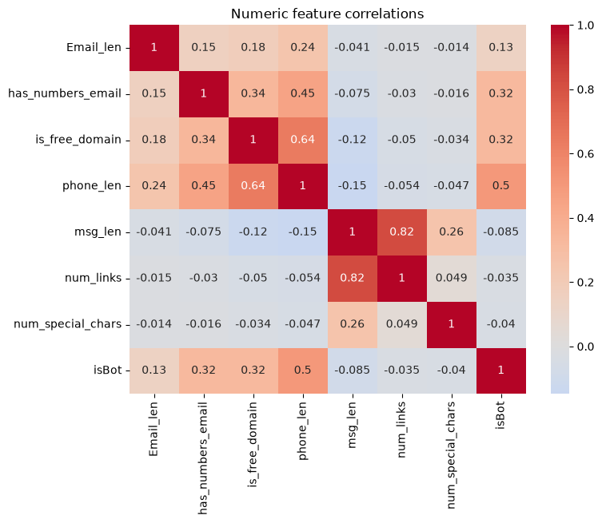
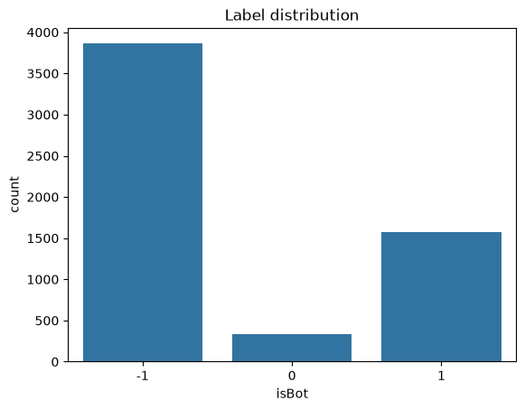

# Form Submission Abuse Detection

A lightweight machine-learning project for detecting abusive or bot-like web form submissions on resource-constrained servers. The project is based on the accompanying paper, **FormTrapAI: A Semi-Supervised Lightweight Framework for Detecting Form Submission Abuse on Low Resource Servers**.

The implementation in `Code/model.ipynb` explores a practical version of the paper's approach: weak labeling, text feature extraction with TF-IDF, behavioral feature engineering, semi-supervised XGBoost self-training, and comparison with logistic regression.

## Table of Contents

- [Problem](#problem)
- [Project Goals](#project-goals)
- [Paper Summary](#paper-summary)
- [Implemented Pipeline](#implemented-pipeline)
- [Features](#features)
- [Models and Evaluation](#models-and-evaluation)
- [Results](#results)
- [Visualizations](#visualizations)
- [Project Structure](#project-structure)
- [Setup and Usage](#setup-and-usage)
- [Limitations and Future Work](#limitations-and-future-work)
- [Reference](#reference)

## Problem

Public forms receive a mixture of genuine submissions, automated spam, and repeated or low-quality bot traffic. Traditional rule-based filters are easy to bypass, while a fully supervised classifier requires a large collection of reliable labels. This is especially difficult for small servers that have limited CPU, memory, and deployment options.

The central challenge is therefore to detect abusive submissions while:

- learning from partially labeled data;
- avoiding label leakage from proxy fields;
- handling text and structured form behavior together; and
- remaining inexpensive enough for CPU-only deployment.

In this project, the `isBot` label is created from the honeypot URL field and the known labeled portion of the dataset. Rows without a reliable label are kept as `-1` for semi-supervised learning.

## Project Goals

1. Build a repeatable preprocessing and feature-engineering workflow for form submissions.
2. Combine message text with email, phone, and behavioral signals.
3. Use unlabeled records through self-training instead of discarding them.
4. Compare a semi-supervised XGBoost classifier with logistic regression.
5. Keep the workflow suitable for a lightweight server environment.

## Paper Summary

The paper presents **FormTrapAI**, a pipeline with four main stages:

1. **Feature extraction** from form text and behavioral fields.
2. **Weak labeling** through a rule engine during training.
3. **Semi-supervised learning** using an XGBoost classifier and an 80% confidence threshold to promote pseudo-labels.
4. **Decision making** that allows or blocks a submission using the frozen model at inference time.

The paper reports a dataset of 5,766 form submissions, 3,037 high-confidence labeled rows, and 2,729 initially unlabeled rows. Its deployment target is a CPU-only server with one virtual core and 512 MB of RAM. The paper reports a 322.2 KB model, 15.41 seconds of training time, 2.54 ms inference latency, and 1.6 MB peak training memory.

The current notebook is an experimental implementation rather than an exact reproduction of every paper experiment. In particular, it currently uses 100 TF-IDF terms and seven engineered numeric features, and the K-means section has been removed from the notebook workflow.

## Implemented Pipeline

```text
CSV data
   |
   v
Cleaning and weak label creation
   |
   +--> TF-IDF features from Message text
   |
   +--> Numeric email, phone, and message features
   |
   v
Sparse text + numeric feature matrix
   |
   +--> XGBoost grid search
   |       |
   |       +--> SelfTrainingClassifier
   |
   +--> Logistic Regression grid search
   |
   v
Holdout evaluation and final comparison
```

### Labeling

The notebook uses three label values:

- `1`: bot, when the honeypot URL field is filled;
- `0`: human, for the known human portion of the data; and
- `-1`: unlabeled, for records that do not have a reliable training label.

### Preprocessing

The notebook fills missing values, removes identifying name fields, and drops timestamp-related columns when present. It derives the following features:

- TF-IDF representation of `Message` text with up to 100 terms;
- `Email_len`;
- `has_numbers_email`;
- `is_free_domain`;
- `phone_len`;
- `msg_len`;
- `num_links`; and
- `num_special_chars`.

The text and numeric matrices are combined with `scipy.sparse.hstack` so the model can work with a compact sparse representation.

## Features

| Feature group | Features |
| --- | --- |
| Text | TF-IDF terms from the message field |
| Email | Email length, numeric characters, free-domain indicator |
| Phone | Phone-number length |
| Message | Message length, link count, special-character count |
| Target | `isBot`: human, bot, or unlabeled |

## Models and Evaluation

### Semi-supervised XGBoost

The notebook tunes an `XGBClassifier` with `GridSearchCV` on the labeled subset, then wraps the selected estimator in `SelfTrainingClassifier`. The self-training stage uses a confidence threshold of `0.8` and can use the unlabeled records during fitting.

The saved notebook output selected these XGBoost parameters:

```text
colsample_bytree: 0.8
learning_rate: 0.05
max_depth: 3
min_child_weight: 1
n_estimators: 100
subsample: 0.8
```

### Logistic regression

A logistic-regression baseline is tuned with a grid over regularization strength, penalty, and class weighting. It is evaluated on the same labeled holdout split.

### Metrics

The notebook reports cross-validation F1, holdout accuracy, weighted F1, and classification reports. The holdout is stratified and uses 30% of the labeled records.

## Results

The values below are the persisted results from the current executed notebook, not claims about a newly trained run.

| Model | CV F1 | Holdout accuracy | Holdout weighted F1 |
| --- | ---: | ---: | ---: |
| XGBoost with self-training | 0.929761 | 0.889860 | 0.877176 |
| Logistic regression | 0.928726 | 0.881119 | 0.871746 |

The current notebook selects **XGBoost with self-training** as the best model by holdout weighted F1.

## Visualizations

These images were exported from the executed notebook outputs and are stored in `docs/images`.

### Numeric feature correlations

The heatmap shows the relationships among the engineered numeric features and the weak target label. In this run, phone length and the bot label show the strongest positive numeric association among the listed features.



### Label distribution

The distribution includes unlabeled rows (`-1`) alongside human (`0`) and bot (`1`) labels. Keeping the unlabeled group visible is important because those records are later used by self-training.



## Project Structure

```text
MLproject/
├── Code/
│   └── model.ipynb
├── Data/
│   ├── dataset.csv
│   └── ml_dataset.csv
├── Paper/
│   └── FormTrapAI__A_Semi_Supervised_Lightweight_Framework_for_Detecting_Form_Submission_Abuse_on_Low_Resource_Servers.pdf
├── docs/
│   └── images/
│       ├── notebook-plot-1.png
│       ├── notebook-plot-2.png
│       └── notebook-plot-3.png
└── README.md
```

## Setup and Usage

### 1. Create an environment

Python 3.10 or newer is recommended.

```bash
python -m venv .venv
```

Activate it on Windows PowerShell:

```powershell
.\.venv\Scripts\Activate.ps1
```

### 2. Install dependencies

```bash
pip install numpy pandas matplotlib seaborn scipy scikit-learn xgboost openpyxl jupyter
```

### 3. Run the notebook

Open `Code/model.ipynb` in VS Code or Jupyter and run the cells from top to bottom. The notebook expects the dataset path relative to the `Code` directory:

```text
../Data/dataset.csv
```

The notebook first attempts to load `../Data/data.xlsx` and falls back to `../Data/dataset.csv` when the Excel file is unavailable.

## Limitations and Future Work

- The current implementation uses proxy labels, so reported performance depends on how closely the proxy reflects real abuse.
- The notebook's feature set is smaller than the 510-feature configuration described in the paper.
- The notebook evaluates offline; it does not yet expose a server endpoint that blocks or allows live form requests.
- A production deployment should add threshold tuning, drift monitoring, model serialization, and an explicit false-positive review process.
- The paper discusses a rule engine and deployment resource measurements that are not fully implemented in the current notebook.
- Personal or sensitive form fields should be minimized, anonymized, or excluded before training.

## Reference

Jahin, A., Tahmid, M. A., and Zaman, S. *FormTrapAI: A Semi-Supervised Lightweight Framework for Detecting Form Submission Abuse on Low Resource Servers.* See the full paper in [`Paper/`](Paper/).
